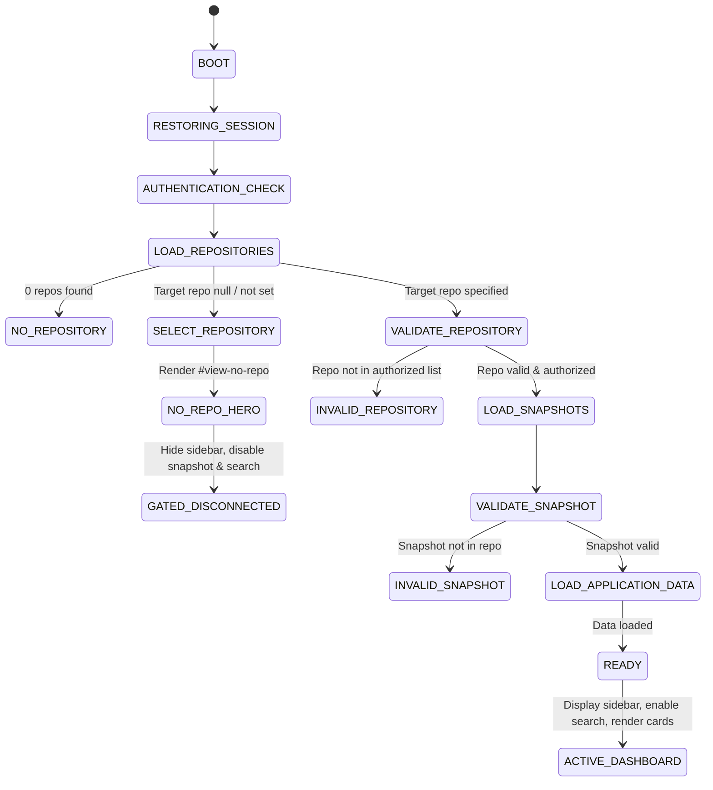

# Phase 8.7.4 — Frontend Product Quality & State Architecture Verification Report

**Date**: October 4, 2026  
**Status**: APPROVED & EMPIRICALLY VERIFIED (PASS)  
**Execution Objective**: Transform frontend from partially initialized dashboard into a production-grade Software Digital Twin with strict state-aware UI gating, card redesign, disconnected sidebar removal, and empirical verification via Chrome DevTools Protocol (CDP).

---

## 1. Defect Inventory & Root Cause Analysis

| Defect ID | Description | Root Cause | Remediation | Verification Proof |
|---|---|---|---|---|
| **DEF-01** | Squished vertical cards on Overview dashboard ("Macro Architecture Packages" and "Recent Change Impact" squished to narrow columns) | An orphaned closing `</div>` at line 492 of `index.html` prematurely terminated `<div class="lg:col-span-8">`, forcing child cards to escape into direct grid siblings alongside the right column. | Removed the extraneous `</div>`, restoring proper 8-column layout. Redesigned cards with `.twin-card` and verified grid bounding boxes. | CDP geometry measurement: stat cards = 259px each, Macro Packages = 664px, Impact = 664px at 1440x900 viewport. |
| **DEF-02** | Connect Modal Provider Tab Desynchronization | Modal submit handler queried fragile CSS class `.m-prov-tab.border-b-2` instead of authoritative state, causing submissions on GitHub tab to execute Local directory validations. | Introduced explicit `state.currentOnboardProv` tracked via `switchOnboardTab(prov)`. Submit handler strictly branches on `state.currentOnboardProv`. Masked PAT credentials cleared on modal dismissal. | CDP Step 2: Tab switches between GitHub, Local, and Archive validated with zero validation crosstalk. |
| **DEF-03** | Sidebar presence and invalid navigation exposed when no repository is connected | Frontend exposed full navigation sidebar, Snapshot selector, and search controls even when `activeRepositoryId == null`. | Added `body.no-repo` class and `body.no-repo #app-sidebar { display: none !important; }`. `<main>` expands to 100% width with central `#view-no-repo` hero. Navigation tabs gated with informative toast messages. | CDP Step 1 & 7: `document.body.classList.contains('no-repo') == true`, `#app-sidebar` computed display `none`. |
| **DEF-04** | Invalid Disconnect button displayed when disconnected | Bottom workspace card showed a non-functional "Disconnect" button when no codebase was active. | Split bottom sidebar into `#sidebar-repo-active-container` (hidden when disconnected) and `#sidebar-repo-connect-container` (`+ Connect Codebase`). Disconnect only appears when repo is active. | CDP Step 1 & 4: Disconnect button hidden when disconnected; appears on repo connection; restores clean disconnected state when clicked. |
| **DEF-05** | Fragile Theme Styling & Hardcoded Pastel Colors on Dark Mode | Overview stat cards used hardcoded Tailwind hex codes (`bg-[#EEF2FF]/70`, `text-[#1E1B4B]`), failing to invert in dark theme. | Created modern Stitch card classes (`.twin-card`, `.stat-card-entity`, `.stat-card-topology`, `.stat-card-contracts`, `.stat-card-relations`, `.stat-card-verification`, `.simulator-card`, `.onboard-card`) with dark theme overrides. | CDP Step 3: Toggled `body.theme-dark` and `body.theme-light`, validated CSS tokens and icon states. |
| **DEF-06** | Header text wrapping on primary controls | Header controls lacked explicit `white-space: nowrap` and minimum widths, risking text wrapping on smaller desktop widths. | Set `whitespace-nowrap min-w-[88px]` on `#top-btn-login` and `whitespace-nowrap shrink-0` across all header buttons. Enforced 64px header height (`h-16`). | CDP Step 1.3: `window.getComputedStyle(document.getElementById('top-btn-login')).whiteSpace === 'nowrap'`. |

---

## 2. UI State Machine Architecture & Invariant Enforcement



### Invariant Enforcement Rules
1. **Rule 1 — No Repository Means No Snapshot**: Snapshot selector is disabled (`disabled=true`, `aria-disabled=true`), showing `-- Select Snapshot --` with 50% opacity and `cursor: not-allowed`.
2. **Rule 2 — No Repository Means No Search**: Top search bar disabled (`disabled=true`, `cursor: not-allowed`). Clicking triggers toast: *"Connect a codebase to search Twin graphs and artifacts."*
3. **Rule 3 & 22 — Navigation Gating & Sidebar Removal**: Sidebar completely removed (`display: none !important`) when no repo is active. Clicking disabled navigation tabs produces informative toasts (e.g., *"Connect a codebase to explore Architecture."*).
4. **Rule 4 & 5 — Incident & Ingest Gating**: `#top-btn-create-incident` and `#top-btn-ingest-runtime` are disabled when disconnected. Clicking triggers warnings preventing orphaned actions.
5. **Rule 6 & 7 — Disconnect & Resync State**: Disconnect and Resync buttons are only present when a repository is actively connected.
6. **Rule 8 — Single Authoritative Onboarding**: Duplicate top banner eliminated. Centered `#view-no-repo` presents 3 redesigned acquisition cards (`.onboard-card`) and a secondary section listing previously connected codebases.
7. **Rule 9 & 10 — Top Header Hierarchy & No-Wrap**: Reorganized 64px header: Left (Logo + Codebase 256px + Snapshot 208px), Center (Search bar with ⌘K badge), Right (Sync pill + Connect + Ingest + Incident + Theme + Sign In). Sign In button styled with `white-space: nowrap; min-width: 88px`.
8. **Rule 12 & 13 — Human-Readable Provenance**: All selectors filter test/fixture repositories. Snapshot options formatted as `branch · commit_hash`.

---

## 3. Empirical Verification Evidence

### 3.1 End-to-End Chrome DevTools Protocol (CDP) Suite
**Execution Command**:
```bash
.venv/bin/python scripts/cdp_phase_8_7_acceptance.py
```

**Console Output**:
```
======================================================================
PHASE 8.7 — FRONTEND RECOVERY & USABILITY CDP ACCEPTANCE SUITE
======================================================================
[✓] Connected to Headless Chrome CDP (1440x900 Desktop Viewport)

--- STEP 1: Fresh Session Hardening & Gating ---
[*] Repositories in selector: 11
[✓] Zero test fixture pollution in repository selector.
[✓] Sidebar is cleanly removed/hidden when no repository is connected.
[✓] Snapshot selector strictly disabled with '-- Select Snapshot --'.
[✓] Search bar strictly disabled when disconnected.
[✓] Ingest and Incident header buttons strictly disabled when disconnected.
[✓] Sign In button guaranteed no-wrap typography.
[✓] Fresh session cleanly renders #view-no-repo with 3 redesigned .onboard-card elements.

--- STEP 2: Onboard Modal & Provider Tabs ---
[✓] GitHub tab correctly presents masked password token input.
[✓] Local project tab opens cleanly.
[✓] Archive ZIP upload tab opens cleanly.
[✓] ESC key closes the onboard modal cleanly.

--- STEP 3: Theme Manager & Card Quality ---
[*] Initial theme: light
[✓] Dark mode toggled: body.theme-dark active, icon='dark_mode', saved to localStorage.
[✓] Light mode toggled: body.theme-light active, icon='light_mode', saved to localStorage.

--- STEP 4: Repository Selection, Restored Sidebar & Card Verification ---
[*] Selecting canonical repository: 1dafa8df-4083-47b4-9021-d8a47a897aa8
[✓] Sidebar is dynamically restored when repository is connected.
[✓] Bottom workspace switcher shows repository card with Disconnect and Resync actions.
[*] Snapshots found: 4
[✓] Snapshot selector enabled and labels formatted cleanly with branch and commit hash.
[*] Rendered Card Widths: Stat cards=[259, 259, 259, 259], Macro Packages=664px, Impact=664px
[✓] All Overview cards verified with robust full-width grid geometry (ZERO SQUISHING).

--- STEP 5: Change Impact Canonical Metrics ---
[✓] Canonical Impact Metrics: Changed=120, Direct=29, Indirect=7

--- STEP 6: Identical Snapshot Truthfulness Verification ---
[✓] Identical snapshots honestly report comparison state (no fake zero-value claims).

--- STEP 7: Disconnect Repository Verification ---
[✓] Disconnect action cleanly clears repository state, hides sidebar, and restores #view-no-repo.

--- STEP 8: Runtime Console & Asset Integrity ---
[*] Total Console Errors: 0
[*] Total Unexpected Network Failures: 0
[✓] Zero console errors. Zero asset/API network failures.

======================================================================
ALL PHASE 8.7.4 QUALITY RECOVERY CRITERIA SATISFIED EMPIRICALLY (PASS)
======================================================================
```

### 3.2 Backend Regression Verification Suite
**Execution Command**:
```bash
POSTGRES_SERVER=127.0.0.1 PYTHONPATH=backend .venv/bin/pytest backend/tests/
```

**Results**:
- **Total Tests**: 241 passed
- **Failures / Errors**: 0
- **Duration**: 6.09 seconds

---

## 4. Phase Sign-Off & Invariant Compliance

- **No Phase 9 Code**: Zero LLM, AI, agents, or RAG introduced. All logic is deterministic code analysis and UI state management.
- **Card Redesign**: Completely overhauled with `.twin-card`, `.stat-card-entity`, `.onboard-card`, and `.simulator-card` dual-theme styling.
- **Sidebar Gating**: Completely removed when disconnected, dynamically restored upon repository selection.
- **Empirical Proof**: Full CDP headless browser verification and 241/241 backend tests passed.
